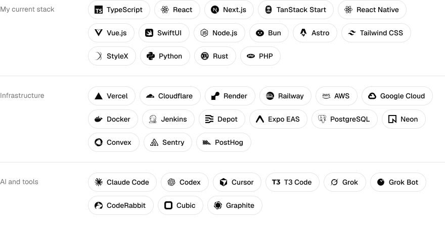

<h1>Rigo Alvarenga</h1>

Tech Lead on the development team at Denzo Studios, in El Salvador. 
I also build my own projects on the side.

  <a href="https://jralvarenga.com">jralvarenga.com</a>
  &nbsp;·&nbsp;
  <a href="https://github.com/jralvarenga">GitHub</a>
  &nbsp;·&nbsp;
  <a href="https://www.linkedin.com/in/jorge-alvarenga-26126b148">LinkedIn</a>
  &nbsp;·&nbsp;
  <a href="https://x.com/rigo_alvarenga1">X</a>

 

## Projects

|                                                   |                                                                       |
| ------------------------------------------------- | --------------------------------------------------------------------- |
| [luvid](https://luvid-design.vercel.app)          | Money tracking you can share, in spaces you invite people into.       |
| [exchange](https://exchange-sigma-ten.vercel.app) | A trading dashboard on Alpaca, with your own keys, encrypted at rest. |
| [better-translate](https://better-translate.com)  | Type-safe i18n for TypeScript, one config across frameworks.          |
| [skills](https://github.com/jralvarenga/skills)   | The rules I give coding agents, packaged as Agent Skills.             |

## Stack

What I build with today, by kind. It's the same list as my [about page](https://jralvarenga.com/about).

<picture>
  <source
    media="(prefers-color-scheme: dark)"
    srcset=".github/readme/stack-dark.svg"
  >
  
</picture>
